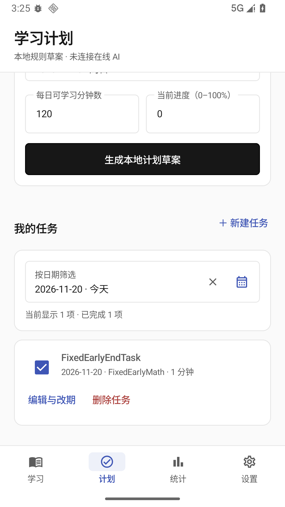
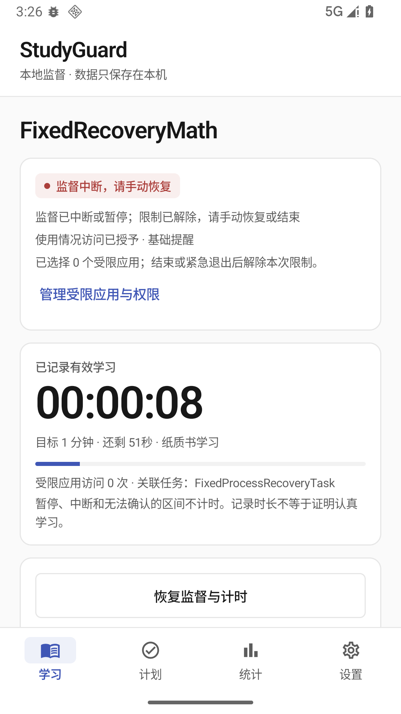
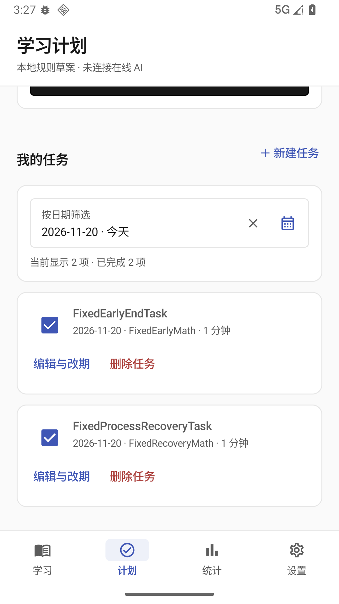

# StudyGuard 0.3.5-dev 验证报告

验证日期：2026-11-20。包名 `io.studyguard.app`，versionCode 14；最低 Android 8.0/API 26，targetSdk 36，compileSdk 36.1。

## 本版修复

1. 提前结束勾选「同时将任务标为已完成」后，关联任务正确完成；服务先停止、页面稍后保存时也沿用同一结束请求。
2. 会话持久保存关联任务编号，强停后重开应用仍可恢复关联；恢复后达到目标自动完成原任务，停机期间不补计未知时间。

Room 11→12 显式新增可空 `linkedTaskId`，保留旧表和记录；旧会话不猜测任务关联。JSON 备份兼容 schema11 的原始校验和及 schema12，恢复后重新映射任务编号。

## 构建与自动测试

| 项目 | 结果 | 证据 |
| --- | --- | --- |
| JVM 单元测试 | 14 个测试类，182 项，0 失败/错误/跳过 | [standard-tests.json](evidence/0.3.5-dev/standard-tests.json) |
| Android 16/API 36 | `StudyPersistenceTest` 17 项通过 | [persistence-final.txt](evidence/0.3.5-dev/persistence-final.txt) |
| 数据升级 | 10→12 与 11→12 设备迁移通过；宿主机结构校验通过 | 上述测试日志 |
| 旧版覆盖升级 | 0.3.4 Release→0.3.5 Debug：设置、1 任务/待办、3 会话、59 分段、12 事件一致 | [upgrade-preservation.json](evidence/0.3.5-dev/upgrade-preservation.json) |
| 构建 | Debug、AndroidTest、R8 Release 成功 | 本次交付构建 |
| Lint Debug | 0 errors、31 warnings、10 hints | 本次本地检查 |

数据库重开、服务停止竞争、紧急结束幂等、未知时长不补计、备份任务编号重映射与删除任务后导出均有设备用例覆盖。

## Release 安装包实际操作

对交付 Release APK 在 Android 16 官方模拟器上操作验证：

- 关联测试任务开始学习，勾选同时完成后提前结束，计划页显示任务已完成。
- 关联另一任务开始学习并暂停/恢复，再强停应用；重开后任务仍关联，已记录的 8 秒不变。
- 手动恢复监督并达到 1 分钟目标，原关联任务自动完成。

操作记录见 [release-ui-verified.txt](evidence/0.3.5-dev/release-ui-verified.txt)，结果见 [release-ui-results.json](evidence/0.3.5-dev/release-ui-results.json)。截图中的任务和科目均为合成测试数据。

| 提前结束完成任务 | 进程中断后保留关联 | 恢复后自动完成 |
| --- | --- | --- |
|  |  |  |

## 安装包与对应源码

Release APK：`StudyGuard-0.3.5-dev-release.apk`，2,491,225 字节。

SHA-256：`83bb034175ecd11888a5c56177daee668e9ab0cede0ca91b3d8269e469d6079d`。

APK Signature Scheme v2 验证通过；开发证书 SHA-256：`2787e9a025cbd6606ac2ec05415432513ada6732360ce4dc2abb22e049e938bf`，与已有 StudyGuard 开发版相同。

Release 附件提供安装包、对应源码归档、`SHA256SUMS.txt` 和逐文件 `SOURCE_MANIFEST.sha256`。首次公开整理只调整项目说明、构建流程和打包脚本，运行时代码与本次已测试安装包对应。

## 验证范围

本轮设备验证仅使用 Android 16 官方模拟器，集中覆盖两个任务关联问题及相关数据路径。之前识别的两处日历测试定位/断言问题未在本轮修改，不能据此宣称全部设备用例通过。

厂商真机、其他 Android 版本、长期后台运行和耗电尚未验收。在线大模型未接入，计划与总结仍是本地规则。安装包使用开发签名，当前作为开发预览版提供。
