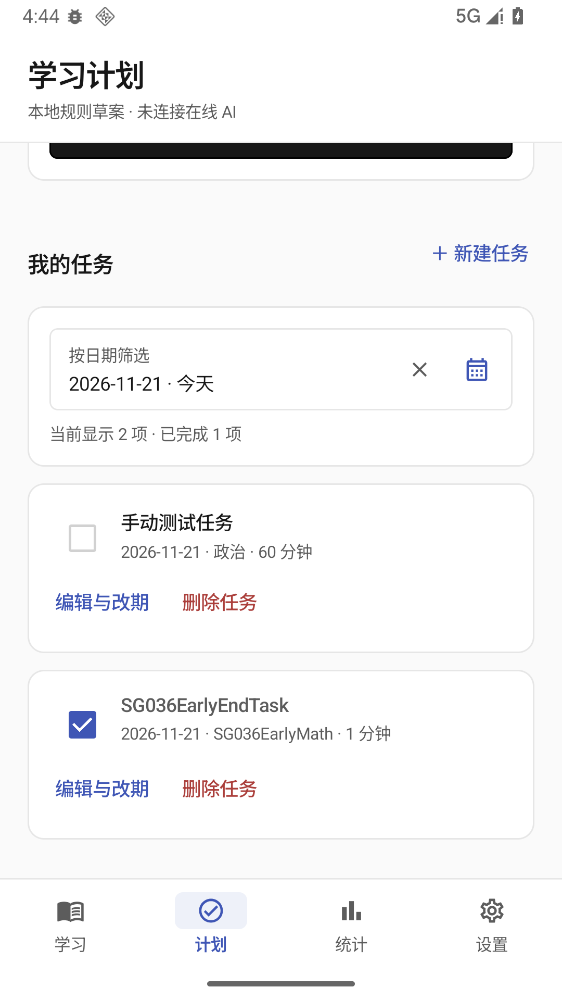
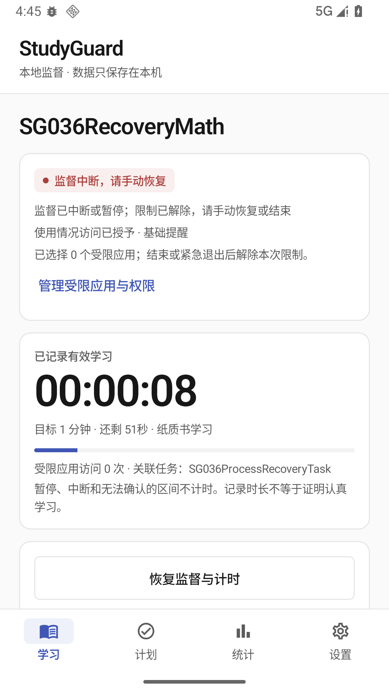
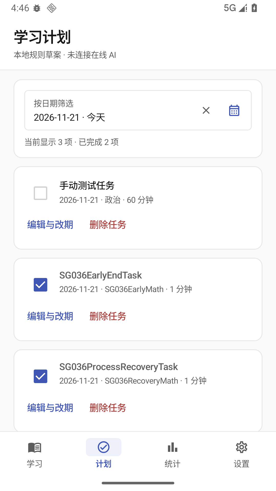

# StudyGuard 0.3.6-dev 验证报告

日期：2026-11-21。包名 `io.studyguard.app`，versionCode 15，minSdk 26、targetSdk 36、compileSdk 36.1。本版为公开开发预览版，下载见 [GitHub Release](https://github.com/vanvan-program/StudyGuard/releases/tag/v0.3.6-dev)。

## 本版改进

学习任务改为独立保存标题、科目、计划日期、时长、完成状态和时间，不再借用原版待办记录。原版待办的删除、过期清理及备份恢复不会级联删除学习任务；学习任务的编辑、打卡和删除也不会改动同编号普通待办。

Room 12→13 显式迁移保留任务编号、任务内容、完成时间和学习会话关联，仅移除旧学习表明确引用的待办镜像。保留自增序列，防止旧会话关联到编号被复用的新任务；空任务表也有设备回归用例。10→13、11→13 迁移路径继续保留旧待办及学习记录。

新学习备份不再包含原版待办；兼容 schema11、schema12 的原始校验和，将旧任务与对应待办转换为独立学习任务。恢复时重新映射任务编号，不修改普通待办；损坏备份在写入前拒绝。

修正日历年月标题的合并语义节点定位，以及日期字段容器的子节点断言。新建/删除任务测试先关闭系统输入法、等待新增成功提示消失、滚动至按钮，再验证任务确实消失，避免按钮被提示浮层遮挡时点击无效却判定通过。

## 构建与测试

| 项目 | 结果 | 证据 |
| --- | --- | --- |
| JVM 单元测试 | 14 个测试类，183 项通过，0 失败/错误/跳过 | [standard-tests.json](evidence/0.3.6-dev/standard-tests.json) |
| Android 16/API 36 完整设备回归 | `OK (37 tests)`，37 项全部通过 | [instrumentation-final.txt](evidence/0.3.6-dev/instrumentation-final.txt) |
| 设备数据保护用例 | 上述测试中的 22 项通过，含普通待办隔离、旧备份恢复、会话关联与迁移 | [instrumentation-final.txt](evidence/0.3.6-dev/instrumentation-final.txt) |
| 宿主机迁移结构 | 10→11、11→12、12→13 结构与导出 schema 一致，外键检查通过 | [schema-check.txt](evidence/0.3.6-dev/schema-check.txt) |
| 旧版覆盖升级 | schema12→13 的 2 个任务、2 次会话、18 个分段、8 条事件、2 份总结保留；普通待办不变。schema11→13 的设置和 4 个总结日期保留 | [upgrade-preservation.json](evidence/0.3.6-dev/upgrade-preservation.json) |
| 构建 | Debug、AndroidTest 与 R8 Release 成功；最终测试源码重新编译通过 | [build.txt](evidence/0.3.6-dev/build.txt)、[final-test-build.txt](evidence/0.3.6-dev/final-test-build.txt) |
| Lint Debug | 0 errors、31 warnings、10 hints | [lint-debug.txt](evidence/0.3.6-dev/lint-debug.txt) |

新增设备用例还验证：没有剩余学习任务时，迁移后的新任务编号仍大于旧序列，结束历史会话不会完成新任务；重复完成同一任务不会改写首次完成时间，取消完成会清除完成时间。

## Release 实际流程

对本次 Release 安装包在 Android 16 官方模拟器上实际操作：

1. 从合成任务开始学习，勾选同时完成任务后提前结束，计划页显示任务已完成。
2. 关联另一任务开始学习并暂停/恢复，再强停应用。重开后任务关联仍在，已记录的 8 秒保持不变，未知停机时间未补计。
3. 手动恢复监督，到达 1 分钟目标后自动结束，原关联任务自动完成。

机器可读结果：[release-ui-results.json](evidence/0.3.6-dev/release-ui-results.json)。截图均为合成测试任务。

| 提前结束完成任务 | 强停后保留关联 | 恢复后自动完成 |
| --- | --- | --- |
|  |  |  |

## 发布附件与签名

GitHub Release 附带本次验证的安装包、对应提交的源码归档、校验清单与本报告。日常试用选择 `StudyGuard-0.3.6-dev-release.apk`；Debug 和 AndroidTest 包仅供开发测试。本机发布交付目录为项目外层 `deliverables/0.3.6-dev-github/`。

Release APK：2,507,609 字节。SHA-256：`3fb1c53faee73828e7df7ab9f3a93900d7509121e9284315e35f450d08505813`。

APK Signature Scheme v2 验证通过。证书 SHA-256：`2787e9a025cbd6606ac2ec05415432513ada6732360ce4dc2abb22e049e938bf`，与已有开发版一致，可同签名覆盖安装。仍为开发签名，不代表应用商店正式发布。证据：[release-signature.txt](evidence/0.3.6-dev/release-signature.txt)。

发布附件 `StudyGuard-0.3.6-dev-source.zip` 使用 `git archive` 从本次发布提交生成，包含报告引用的测试证据及截图。`artifacts.json` 记录准确的 `sourceCommit`、文件大小及 SHA-256；`SOURCE_MANIFEST.sha256` 用于逐文件核对源码，`SHA256SUMS.txt` 用于核对安装包和源码压缩包。早先本地的 `source-working-tree.zip` 是未提交工作树快照，不作为本次 GitHub 发布附件。

设备测试结束后，已恢复测试前保存的数据库全部记录及原使用情况访问设置，并移除测试生成的新手引导标记。数据库完整性检查和外键检查通过；模拟器中保留本版 Release，随后关闭本轮启动的无窗口模拟器。记录：[cleanup.json](evidence/0.3.6-dev/cleanup.json)。

## 验证边界

本版设备验收仅覆盖 Android 16 官方模拟器。Android 10 测试启动因本机缺少 API 29 系统镜像而未执行，不沿用旧版本测试宣称当前版本跨系统通过。厂商真机、长期锁屏/后台、Doze 和耗电仍待验收。

数据库级导出与恢复有设备用例；系统文件选择器及云盘文档提供方的完整导入/导出流程未在本轮验收。在线大模型未接入，计划与总结继续使用明确标识的本地规则。

本轮不以最初的失败日志判定成功：[初次 35 项回归](evidence/0.3.6-dev/instrumentation-initial.txt)发现两处旧日历测试问题；加强删除结果检查后，[实时截图](screenshots/0.3.6-dev/delete-overlay.png)确认新增成功提示会短暂遮挡删除按钮。实际界面操作已验证删除逻辑正常，测试随后补上浮层等待及删除结果检查，删除专项通过后再运行完整 37 项回归。
